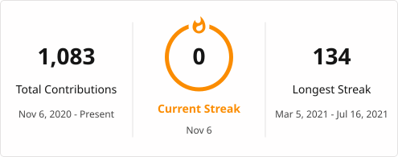

<h1 align="center">Hi 👋, I'm Ash</h1>
<h3 align="center">I'm a software engineer from the New York City metropolitan area.</h3>

- 📫  Reach me at **ashtarcodes@gmail.com**

- Currently working on Investor Basecamp, an app for managing the risk in your equity portfolio.

<h3 align="left">Connect with me:</h3>

<h3 align="left">Languages and Tools:</h3>

    <a href="https://expressjs.com" target="_blank noopener noreferrer"> <picture><source media="(prefers-color-scheme: dark)" srcset="./profile/icons/express-white.svg"></picture> </a>    

  <picture><source media="(prefers-color-scheme: dark)" srcset="./profile/stats-dark.svg"></picture>
  <picture><source media="(prefers-color-scheme: dark)" srcset="./profile/top-langs-dark.svg"></picture>

<picture><source media="(prefers-color-scheme: dark)" srcset="./profile/streak-dark.svg"></picture>

### Check out my pinned projects below
